# System Architecture & Technical Overview

Tài liệu này cung cấp góc nhìn toàn cảnh về mặt kiến trúc phần mềm, ngăn xếp công nghệ (tech stack), cấu trúc mã nguồn và các khía cạnh kỹ thuật xuyên suốt (cross-cutting concerns) của hệ thống **Gia Đình Xanh - Nền Tảng Dịch Vụ Gia Đình 5 Sao** dành cho các kỹ sư phần mềm khi tham gia phát triển dự án.

---

## 1. Executive Summary & Core Architectural Pattern

### 1.1. Mục Tiêu Nghiệp Vụ Chính
**Gia Đình Xanh** là nền tảng số hóa dịch vụ gia đình cao cấp theo mô hình sàn giao dịch dịch vụ theo yêu cầu 3 bên (*3-Sided On-Demand Service Marketplace*), kết nối đồng bộ 3 nhóm đối tượng người dùng:
1. **Khách hàng (Customer)**:
   - Tra cứu, lựa chọn và cấu hình gói dịch vụ đa dạng (Dọn dẹp tiêu chuẩn/chuyên sâu, nấu ăn gia đình, ủi đồ, vệ sinh thiết bị).
   - Đặt lịch linh hoạt (theo giờ, định kỳ, áp dụng mã ưu đãi/voucher).
   - Giám sát tiến độ thực thi dịch vụ theo thời gian thực (*Live Order Tracking* với đồng hồ đếm ngược, danh mục checklist công việc, bằng chứng ảnh nghiệm thu Before/After).
   - Quản lý lịch hẹn và thực hiện đánh giá chất lượng 5 sao kèm tiền tip cho đối tác.
2. **Đối tác hiện trường (Partner - Nhân viên/Cộng tác viên)**:
   - Sàn nhận việc khẩn cấp định vị theo bán kính GPS (*Job Board & Radar Map*).
   - Quản lý ca làm việc trực tiếp (*Live Shift*), đồng hồ tính giờ hiện trường, checklist kiểm chuẩn 5 sao và chụp ảnh nghiệm thu Before/After.
   - Quản lý tài chính cá nhân (*Partner Wallet*), theo dõi thu nhập/chiết khấu, thực hiện rút tiền và đăng ký ma trận lịch làm việc rảnh linh hoạt.
3. **Quản trị vận hành (Admin Operations)**:
   - Giám sát tập trung toàn bộ vòng đời đơn hàng (*Admin Operations Dashboard*), theo dõi trạng thái, điều phối thợ khẩn cấp và xử lý khiếu nại tranh chấp (*Dispute resolution*).
   - Mô phỏng và kiểm thử chính sách giá động (*Dynamic Pricing Engine & Surcharge Sandbox*) theo khung giờ cao điểm, phụ phí cuối tuần và tỷ lệ phân chia doanh thu (*Revenue Split*).
   - Quy trình thẩm định và kích hoạt đối tác 4 bước theo tiêu chuẩn nghiêm ngặt (*Partner KYC Verification*: Định danh CCCD, Phiếu lý lịch tư pháp, Giấy khám sức khỏe, Sát hạch lý thuyết & tay nghề).

### 1.2. Mô Hình Kiến Trúc Cốt Lõi (Core Architectural Pattern)
- **Mô hình tổng thể hiện tại**: **Client-Side Single Page Application (SPA)** theo định hướng **Component-Driven Modular Architecture**.
- **Cơ chế điều phối giao diện (State-Driven Screen Routing)**: Dự án hiện không sử dụng thư viện định tuyến URL truyền thống (như `react-router-dom`), mà triển khai bộ điều hướng trạng thái tập trung thông qua biến trạng thái `currentScreen` (kiểu `ScreenId`) tại `src/App.tsx`, kết hợp cùng thanh công cụ điều hướng nổi `src/components/PlatformSwitcher.tsx`. Cơ chế này cho phép các kỹ sư, kiểm thử viên và các bên liên quan chuyển đổi nhanh chóng giữa 10 màn hình chức năng của cả 3 phân hệ (Customer, Partner, Admin) mà không làm mất trạng thái ứng dụng.
- **Mô hình dữ liệu (In-Memory & Fixture-Driven State)**: Toàn bộ dữ liệu nghiệp vụ (danh sách đơn hàng, dữ liệu đối tác KYC, cấu hình đơn giá, trạng thái checklist, tài sản hình ảnh) được cấu trúc hóa dưới dạng fixtures tại `src/data/mockData.ts` và quản lý trạng thái động thông qua React Hooks nội bộ (`useState`, `useEffect`).
- **Hiện trạng Backend & AI**:
  - Trong `package.json`, dự án có khai báo các thư viện nền tảng phía máy chủ và AI bao gồm `express`, `dotenv` và `@google/genai`. Đồng thời, tệp `metadata.json` khai báo quyền năng `MAJOR_CAPABILITY_SERVER_SIDE_GEMINI_API`.
  - Tuy nhiên, trong mã nguồn hiện thời, **chưa triển khai mã nguồn Backend/API Server** (chưa có tệp `server.ts` hay các endpoint Express) và **chưa tích hợp lệnh gọi Gemini API thực tế**. Hệ thống hiện hoạt động dưới dạng một ứng dụng nguyên mẫu tương tác cao cấp (*High-Fidelity Interactive Prototype / Application Sandbox*) chạy trên nền Vite Dev Server.

---

## 2. Technology Stack & Ecosystem

Chi tiết ngăn xếp công nghệ được trích xuất trực tiếp từ các tệp cấu hình (`package.json`, `tsconfig.json`, `vite.config.ts`, `metadata.json`):

### 2.1. Runtime & Language
| Thành phần | Công nghệ / Phiên bản | Ghi chú & Nguồn xác thực |
| :--- | :--- | :--- |
| **JavaScript Runtime** | Node.js (Hỗ trợ Bun) | Xác thực qua `package.json` scripts và tệp `bun.lock` tại thư mục gốc |
| **Ngôn ngữ lập trình** | TypeScript `^7.0.2` | Cấu hình trong `package.json` (devDependencies) |
| **Compilation Target** | `ES2022`, Module: `ESNext` | Xác thực từ `tsconfig.json` (`target: "ES2022"`, `moduleResolution: "bundler"`) |
| **JSX Runtime** | `react-jsx` | Tự động biên dịch JSX không cần import React thủ công (`tsconfig.json`) |

### 2.2. Frameworks & Core Libraries
| Phân loại | Thư viện / Phiên bản | Mục đích kỹ thuật |
| :--- | :--- | :--- |
| **UI Framework** | React `^19.0.1` / React DOM `^19.0.1` | Thư viện nền tảng xây dựng giao diện người dùng theo component |
| **Build Tool / Bundler**| Vite `^8.3.0` | Công cụ đóng gói mã nguồn tốc độ cao, hỗ trợ HMR và plugin |
| **React Vite Plugin** | `@vitejs/plugin-react` `^6.1.1` | Plugin tích hợp React cho Vite với hỗ trợ Fast Refresh |
| **CSS Framework** | Tailwind CSS `^4.3.3` (`@tailwindcss/vite` `^4.3.3`) | Framework Utility-first CSS thế hệ 4 cấu hình trực tiếp qua CSS variables |
| **Animation Library** | Motion `^12.23.24` | Thư viện hiệu ứng chuyển động chuyên sâu cho React (Framer Motion v12) |
| **Icon Libraries** | `lucide-react` `^0.546.0` & Google Material Symbols | Bộ icon SVG hiện đại kết hợp font icon Material Symbols tải qua Google Fonts CDN |
| **Web Fonts** | Plus Jakarta Sans | Font chữ chính của hệ thống, tải từ Google Fonts CDN tại `index.html` |
| **Backend & GenAI (Khai báo)** | `express` `^4.21.2`, `@google/genai` `^2.4.0` | Thư viện Web server và Gemini SDK được khai báo sẵn trong `package.json` |
| **State Management** | *Not configured/Found* | Sử dụng React Core State (`useState`, `useEffect`), chưa dùng Redux/Zustand |
| **ORM / ODM** | *Not configured/Found* | Chưa có cơ sở dữ liệu vật lý kết nối |

### 2.3. Database, Cache & Message Queues
| Thành phần | Trạng thái kỹ thuật | Mô tả chi tiết |
| :--- | :--- | :--- |
| **Relational Database** | *Not configured/Found* | Không tìm thấy PostgreSQL, MySQL hay SQLite |
| **NoSQL Database** | *Not configured/Found* | Không tìm thấy MongoDB hay Firestore |
| **In-Memory Data Store**| Tạm thời (Mock) | Sử dụng cấu trúc dữ liệu tĩnh TypeScript tại `src/data/mockData.ts` |
| **Cache Store** | *Not configured/Found* | Không tìm thấy Redis hay Memcached |
| **Message Queues** | *Not configured/Found* | Không tìm thấy RabbitMQ, Kafka hay AWS SQS/PubSub |

### 2.4. Infrastructure, Tooling & CI/CD
| Thành phần | Trạng thái kỹ thuật | Ghi chú & Nguồn xác thực |
| :--- | :--- | :--- |
| **Containerization** | *Not configured/Found* | Không có `Dockerfile` hoặc `docker-compose.yml` trong mã nguồn |
| **Orchestration** | *Not configured/Found* | Không có cấu hình Kubernetes (K8s) |
| **CI/CD Pipelines** | *Not configured/Found* | Không có thư mục `.github/workflows` hay GitLab CI |
| **Cloud Runtime / Hosting**| Google AI Studio / Cloud Run | Tích hợp qua `metadata.json` (`MAJOR_CAPABILITY_SERVER_SIDE_GEMINI_API`) và `.env.example` (`APP_URL`) |
| **Development Tooling** | `tsx` `^4.21.0`, `esbuild` `^0.25.0` | Công cụ thực thi TypeScript và đóng gói phụ trợ |

---

## 3. High-Level System Architecture (Mermaid)

Sơ đồ dưới đây mô tả luồng kiến trúc hệ thống tổng thể, mối quan hệ giữa người dùng, tầng điều phối trạng thái, các phân hệ chức năng và các dịch vụ bên ngoài:

```mermaid
graph TD
    %% User Roles & Client Presentation
    subgraph Client_Layer ["Client & User Presentation Layer (Browser)"]
        CustomerUser["Khách Hàng (Customer)"]
        PartnerUser["Đối Tác Hiện Trường (Partner)"]
        AdminUser["Quản Trị Viên (Admin Ops)"]
        SwitcherWidget["Thanh Điều Hướng 10 Màn Hình (PlatformSwitcher.tsx)"]
    end

    %% Application Coordinator Layer
    subgraph App_Core ["Application Routing & Coordination Layer (React 19 + Vite)"]
        IndexHTML["index.html (Entrypoint & CDNs)"]
        MainTSX["main.tsx (createRoot / StrictMode)"]
        AppTSX["App.tsx (Screen State Router)"]
        ScreenState{"currentScreen: ScreenId"}
    end

    %% Functional Subsystems
    subgraph Subsystems ["Functional Subsystems (src/components)"]
        subgraph Customer_Subsystem ["Phân Hệ Khách Hàng (src/components/customer)"]
            Landing["CustomerLanding.tsx (Trang chủ & Đặt nhanh)"]
            Booking["CustomerBooking.tsx (Cấu hình dịch vụ Wizard)"]
            Tracking["CustomerTracking.tsx (Theo dõi đơn hàng Live)"]
            Appointments["CustomerAppointments.tsx (Lịch hẹn & Lịch sử)"]
            RatingModal["RatingModal.tsx (Popup Đánh giá 5 sao & Tip)"]
        end

        subgraph Partner_Subsystem ["Phân Hệ Đối Tác (src/components/partner)"]
            PartnerShift["PartnerShift.tsx (Ca làm việc & Live Timer)"]
            PartnerBoard["PartnerJobBoard.tsx (Sàn nhận việc & Radar GPS)"]
            PartnerWallet["PartnerWallet.tsx (Quản lý Ví & Lịch rảnh)"]
        end

        subgraph Admin_Subsystem ["Phân Hệ Quản Trị (src/components/admin)"]
            AdminDash["AdminDashboard.tsx (Điều hành & Điều phối thợ)"]
            AdminPricing["AdminPricing.tsx (Pricing Engine & Sandbox)"]
            AdminKYC["AdminKYC.tsx (Thẩm định hồ sơ đối tác 4 bước)"]
        end
    end

    %% Data & State Storage Layer
    subgraph Data_Layer ["Data & State Simulation Layer"]
        LocalState["Component Local State (useState / useEffect Timers)"]
        MockFixtures["Mock Data Fixtures (src/data/mockData.ts)"]
    end

    %% External Infrastructure & Services
    subgraph External_Services ["External Infrastructure & Cloud Resources"]
        GoogleFonts["Google Fonts & Material Symbols CDN"]
        ImageCDN["Google User Content Image Hosting (Avatars, Proofs)"]
        AIStudioEnv["Google AI Studio / Cloud Run Environment (Target Config)"]
    end

    %% Protocol Annotations & Connections
    CustomerUser -->|DOM Events| Landing
    CustomerUser -->|DOM Events| Booking
    CustomerUser -->|DOM Events| Tracking
    CustomerUser -->|DOM Events| Appointments
    CustomerUser -->|DOM Events| RatingModal

    PartnerUser -->|DOM Events| PartnerShift
    PartnerUser -->|DOM Events| PartnerBoard
    PartnerUser -->|DOM Events| PartnerWallet

    AdminUser -->|DOM Events| AdminDash
    AdminUser -->|DOM Events| AdminPricing
    AdminUser -->|DOM Events| AdminKYC

    CustomerUser -.->|Switch View| SwitcherWidget
    PartnerUser -.->|Switch View| SwitcherWidget
    AdminUser -.->|Switch View| SwitcherWidget

    IndexHTML -->|Loads Bundle| MainTSX
    MainTSX -->|Renders| AppTSX
    AppTSX -->|Controls| ScreenState

    SwitcherWidget -->|Callback: onSelectScreen| ScreenState
    ScreenState -->|State Dispatch| Landing
    ScreenState -->|State Dispatch| Booking
    ScreenState -->|State Dispatch| Tracking
    ScreenState -->|State Dispatch| Appointments
    ScreenState -->|State Dispatch| PartnerShift
    ScreenState -->|State Dispatch| PartnerBoard
    ScreenState -->|State Dispatch| PartnerWallet
    ScreenState -->|State Dispatch| AdminDash
    ScreenState -->|State Dispatch| AdminPricing
    ScreenState -->|State Dispatch| AdminKYC
    AppTSX -->|State: ratingModalOpen| RatingModal

    Landing -.->|In-Memory Bind| MockFixtures
    Tracking -.->|In-Memory Bind| MockFixtures
    AdminDash -.->|In-Memory Bind| MockFixtures
    AdminKYC -.->|In-Memory Bind| MockFixtures
    PartnerShift -.->|In-Memory Bind| MockFixtures
    PartnerBoard -.->|In-Memory Bind| MockFixtures

    Tracking -->|Local Timer & State| LocalState
    PartnerShift -->|Countdown Interval| LocalState
    AdminPricing -->|Simulated Pricing State| LocalState
    PartnerWallet -->|Schedule Matrix State| LocalState

    IndexHTML -->|HTTPS Request| GoogleFonts
    MockFixtures -->|HTTPS Image Asset URL| ImageCDN
    AppTSX -.->|Declared In Metadata / .env| AIStudioEnv

    %% Backend & Distributed Services (Not Configured Notice)
    classDef missing fill:#fee2e2,stroke:#ef4444,stroke-width:1px,stroke-dasharray: 5 5;
    classDef simulated fill:#e0f2fe,stroke:#0284c7,stroke-width:1px;
    class Data_Layer simulated;
```



> **Ghi chú về các giao thức giao tiếp:**
> - **Giao tiếp nội bộ UI**: Sử dụng **DOM Event Handlers**, **React Props Callbacks** và **State Dispatchers**.
> - **Tài nguyên tĩnh bên ngoài**: Giao tiếp qua **HTTPS** đến Google Fonts API, Material Symbols CDN và Google User Content Server (chứa hình ảnh đối tác, ảnh Before/After và hồ sơ KYC).
> - **REST / GraphQL / gRPC / WebSockets / Pub/Sub**: **Not configured/Found** trong mã nguồn hiện thời. Các tính năng thời gian thực (như đồng hồ ca làm, radar tìm đơn, checklist) hiện đang được giả lập bằng `setInterval` và Local State.

---

## 4. Repository Directory Structure

Dưới đây là cấu trúc cây thư mục chi tiết của dự án (tối đa độ sâu 3 cấp), đã loại bỏ các thư mục phát sinh/tạm thời (`node_modules`, `dist`):

```text
gia-đình-xanh---nền-tảng-dịch-vụ-gia-đình-5-sao/
├── .env.example              # [Config] Mẫu biến môi trường (GEMINI_API_KEY, APP_URL)
├── .gitignore                # [VCS] Danh sách tệp và thư mục bỏ qua trong Git
├── bun.lock                  # [Dependency] Lockfile của Bun package manager (hiện rỗng)
├── index.html                # [Entrypoint] Tệp HTML gốc, nhúng Google Fonts & Icons
├── metadata.json             # [Platform] Metadata ứng dụng trên Google AI Studio
├── package.json              # [Config] Khai báo dependencies, devDependencies và npm scripts
├── README.md                 # [Doc] Hướng dẫn cài đặt và khởi chạy dự án cục bộ
├── tsconfig.json             # [Config] Cấu hình TypeScript compiler (ES2022, path alias @/*)
├── vite.config.ts            # [Build] Cấu hình đóng gói Vite, tích hợp Tailwind CSS v4 & HMR
└── src/                      # [Source] Thư mục chứa toàn bộ mã nguồn ứng dụng
    ├── App.tsx               # [Coordinator] Component gốc điều phối trạng thái hiển thị 10 màn hình
    ├── index.css             # [Styles] Tệp CSS chính cấu hình Tailwind v4 @theme, animation & scrollbar
    ├── main.tsx              # [Bootstrap] Khởi tạo React Virtual DOM (createRoot, StrictMode)
    ├── components/           # [UI Components] Chứa toàn bộ giao diện chia theo phân hệ người dùng
    │   ├── PlatformSwitcher.tsx  # Thanh điều hướng nổi hỗ trợ chuyển đổi nhanh giữa 10 màn hình
    │   ├── admin/            # Phân hệ Quản trị vận hành (Admin Operations)
    │   │   ├── AdminDashboard.tsx # Bảng điều hành giám sát đơn, thợ và xử lý khiếu nại
    │   │   ├── AdminKYC.tsx       # Giao diện xét duyệt hồ sơ đối tác 4 bước chuẩn 5 sao
    │   │   └── AdminPricing.tsx   # Công cụ mô phỏng chính sách giá và tỷ lệ chia sẻ doanh thu
    │   ├── customer/         # Phân hệ Khách hàng (Customer Portal)
    │   │   ├── CustomerAppointments.tsx # Danh sách lịch hẹn đã đặt, đang chờ và lịch sử
    │   │   ├── CustomerBooking.tsx      # Luồng đặt lịch dịch vụ nhiều bước (Wizard form)
    │   │   ├── CustomerLanding.tsx      # Trang chủ giới thiệu dịch vụ và đặt nhanh
    │   │   ├── CustomerTracking.tsx     # Giao diện theo dõi tiến độ công việc trực tiếp (Live Tracking)
    │   │   └── RatingModal.tsx          # Modal đánh giá chất lượng 5 sao và tip cho đối tác
    │   └── partner/          # Phân hệ Đối tác hiện trường (Partner App)
    │       ├── PartnerJobBoard.tsx      # Sàn nhận việc khẩn cấp tích hợp radar GPS mô phỏng
    │       ├── PartnerShift.tsx         # Màn hình ca làm việc, đồng hồ đếm ngược và checklist
    │       └── PartnerWallet.tsx        # Quản lý ví thu nhập, rút tiền và ma trận lịch rảnh
    ├── data/                 # [Mock Data] Dữ liệu mẫu phục vụ phát triển và kiểm thử
    │   └── mockData.ts       # Fixtures danh sách đơn hàng, hồ sơ KYC và CDN URLs hình ảnh
    └── types/                # [TypeScript Definitions] Các định nghĩa kiểu dữ liệu dùng chung
        └── index.ts          # Định nghĩa ScreenId, UserRole, OrderItem, KYCCandidate
```

### Chú Thích Mục Đích Kỹ Thuật Các Thư Mục & Tệp Trọng Yếu:
1. **`src/App.tsx`**: Đóng vai trò là "Central View Router". Sử dụng React state `currentScreen` để render có điều kiện một trong 10 màn hình, đảm bảo tính toàn vẹn của một Application Prototype độc lập không phụ thuộc vào server-side rendering hay trình quản lý URL bên ngoài.
2. **`src/components/PlatformSwitcher.tsx`**: Công cụ chuyển đổi màn hình dạng floating panel cố định ở góc dưới bên phải màn hình, gom nhóm 10 màn hình theo 3 vai trò (`customer`, `partner`, `admin`) giúp việc demo và kiểm thử luồng sản phẩm trực quan.
3. **`src/components/customer/`**: Đóng gói các tính năng hướng đến người dùng cuối gồm luồng đặt đơn phức hợp (`CustomerBooking`), theo dõi hiện trạng đơn hàng với ảnh Before/After (`CustomerTracking`), và hệ thống phản hồi 5 sao (`RatingModal`).
4. **`src/components/partner/`**: Mô phỏng giao diện thiết bị di động của người giúp việc với ca làm việc có đồng hồ đếm ngược (`PartnerShift`), sàn việc làm lọc theo bán kính 2km - 10km (`PartnerJobBoard`), và ma trận đăng ký ca rảnh theo tuần (`PartnerWallet`).
5. **`src/components/admin/`**: Bảng điều khiển quản trị tập trung với bộ lọc trạng thái đơn hàng nâng cao (`AdminDashboard`), công cụ giả lập doanh thu/giá sàn (`AdminPricing`), và quy trình duyệt hồ sơ nhân sự khắt khe (`AdminKYC`).
6. **`src/data/mockData.ts`**: Nguồn dữ liệu tập trung cung cấp các đối tượng `OrderItem`, `KYCCandidate` và bộ ảnh chụp hiện trường Before/After, chân dung nhân viên, ảnh CCCD/Lý lịch tư pháp lưu trữ trên CDN.
7. **`src/index.css`**: Cấu hình hệ thống thiết kế (*Design System Tokens*) bằng tính năng `@theme` mới của Tailwind CSS v4, định nghĩa bảng màu chuẩn (Primary Emerald `#005c55`, Secondary Orange `#a73a00`, Surface `#faf8ff`), font Plus Jakarta Sans và keyframe animations cho hiệu ứng sóng radar (`pulse-ring`, `radar-pulse`).

---

## 5. Key Cross-Cutting Concerns

### 5.1. Cơ Chế Authentication & Authorization
- **Authentication (Xác thực danh tính)**:
  - Hiện trạng: **Not configured/Found**.
  - Không tìm thấy cơ chế xác thực người dùng bằng JWT (JSON Web Token), Cookie Session, HTTP-Only Cookie hay OAuth2 / OpenID Connect.
- **Authorization & Phân Quyền (RBAC)**:
  - Hiện trạng: **Logic RBAC được mô phỏng ở tầng Client** (*Simulated Role-Based Access Control*).
  - Hệ thống định nghĩa 3 vai trò trong `src/types/index.ts`:
    ```typescript
    export type UserRole = 'customer' | 'partner' | 'admin';
    ```
  - Thay vì kiểm tra phân quyền từ token/backend, thanh điều phối `PlatformSwitcher.tsx` phân loại màn hình theo 3 nhóm vai trò trên. Người dùng có thể tự do chuyển đổi giữa các vai trò mà không cần đăng nhập thực tế.

### 5.2. Quản Lý Cấu Hình & Biến Môi Trường
- **Tệp định nghĩa mẫu**: `.env.example` cung cấp các biến môi trường:
  ```env
  GEMINI_API_KEY="MY_GEMINI_API_KEY"
  APP_URL="MY_APP_URL"
  ```
  - `GEMINI_API_KEY`: Dành riêng cho việc gọi API Google Gemini khi triển khai trên Google AI Studio.
  - `APP_URL`: URL dịch vụ Cloud Run được môi trường AI Studio tự động chèn vào khi khởi tạo applet.
- **Xử lý biến môi trường trong Build Tool (`vite.config.ts`)**:
  - Tệp `vite.config.ts` kiểm tra biến môi trường `DISABLE_HMR`:
    ```typescript
    server: {
      hmr: process.env.DISABLE_HMR !== 'true',
      watch: process.env.DISABLE_HMR === 'true' ? null : {},
    }
    ```
    Mục đích: Tắt tính năng Hot Module Replacement và theo dõi file khi chạy trong môi trường tự động hóa agent của AI Studio nhằm tiết kiệm tài nguyên CPU và tránh giật lag giao diện.
- **Truy xuất biến môi trường trong mã nguồn Client**:
  - Mã nguồn trong thư mục `src/` hiện **chưa sử dụng** `import.meta.env` hay `process.env`.
- **Secret Manager**:
  - **Not configured/Found**. Dự án chưa tích hợp các giải pháp quản lý khóa bí mật chuyên biệt như HashiCorp Vault, AWS Secrets Manager hay Google Secret Manager.

### 5.3. Logging, Tracing & Monitoring
- **Logging (Ghi nhật ký)**:
  - Hiện trạng: **Not configured/Found**.
  - Không có thư viện ghi log chuyên nghiệp (như Winston, Pino, Bunyan hay Morgan).
  - Hệ thống hiện tại chỉ sử dụng các lệnh tương tác cơ bản của trình duyệt như `alert(...)` (ví dụ thông báo nhận đơn tại `src/components/partner/PartnerJobBoard.tsx`) và `console.log` mặc định của DevTools.
- **Tracing & APM (Theo dõi phân tán)**:
  - Hiện trạng: **Not configured/Found**.
  - Không tìm thấy cấu hình OpenTelemetry, Jaeger hay Zipkin.
- **Error Tracking & Health Monitoring**:
  - Hiện trạng: **Not configured/Found**.
  - Chưa tích hợp các nền tảng giám sát lỗi người dùng như Sentry, LogRocket, Datadog hay Prometheus/Grafana.

---

## 6. Architectural Insights & Recommendations for Engineers

Đối với các kỹ sư mới tham gia phát triển dự án từ giai đoạn nguyên mẫu này lên hệ thống sản xuất thương mại (*Production-Ready System*), những khoảng cách kiến trúc (*architectural gaps*) cần ưu tiên xử lý bao gồm:

1. **Triển khai Tầng API Backend**:
   - Hiện thực hóa Express server (đã có trong `package.json`) hoặc xây dựng NestJS / Go / FastAPI service độc lập.
   - Chuyển đổi dữ liệu từ `src/data/mockData.ts` sang các hệ quản trị cơ sở dữ liệu quan hệ (PostgreSQL cho đơn hàng, người dùng, giao dịch ví) và phi quan hệ (MongoDB / Firestore cho log hiện trường, hình ảnh kiểm tra).
2. **Triển khai Giao thức Thời Gian Thực (Real-Time Communication)**:
   - Thay thế việc mô phỏng `setInterval` bằng kết nối **WebSocket** (qua Socket.io hoặc WebPubSub) để đồng bộ trạng thái đơn hàng tức thì giữa Khách hàng (`CustomerTracking`), Đối tác (`PartnerShift`) và Quản trị viên (`AdminDashboard`).
3. **Cơ Chế Bảo Mật & Xác Thực Thật**:
   - Tích hợp chuẩn **OAuth 2.0 / JWT** kèm Refresh Token và HttpOnly Cookie.
   - Thiết lập Middleware phân quyền RBAC chặt chẽ tại Backend trước khi cho phép truy cập dữ liệu Admin hay ví tiền của Đối tác.
4. **Tích hợp Dịch vụ Lưu Trữ Tệp (Object Storage)**:
   - Xây dựng endpoint tải ảnh (Pre-signed URL lên AWS S3 hoặc Google Cloud Storage) để lưu trữ ảnh chụp hiện trạng Before/After và ảnh hồ sơ xác minh KYC thay vì liên kết tĩnh qua Google User Content.
