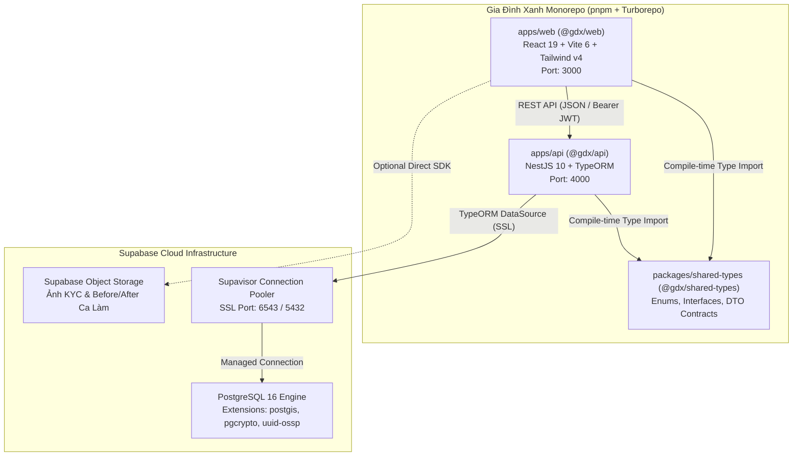

# System Architecture & Technical Overview

## 1. Executive Summary & Core Architectural Pattern
- **Mô hình kiến trúc cốt lõi:** **Full-Stack TypeScript Monorepo (`pnpm` Workspaces + `Turborepo`)** kết hợp **Modular Monolith Backend (NestJS Domain-Driven Modules)** và **Cloud Managed Database (Supabase PostgreSQL 16)**.
- **Chiến lược môi trường phát triển:** **Zero-Docker Architecture** — Khóa phiên bản Node.js qua [`.nvmrc`](file:///d:/hao/Downloads/html/gia-%C4%91%C3%ACnh-xanh---n%E1%BB%81n-t%E1%BA%A3ng-d%E1%BB%8Bch-v%E1%BB%A5-gia-%C4%91%C3%ACnh-5-sao/.nvmrc), cô lập phụ thuộc qua `pnpm` Virtual Store và kết nối trực tiếp tới **Supabase Cloud** qua SSL Connection Pooler (port `6543`/`5432`), loại bỏ hoàn toàn xung đột cổng `5432` cục bộ và tiết kiệm 2–4GB RAM máy phát triển.
- **Mục tiêu nghiệp vụ chính:** Giải quyết bài toán sàn dịch vụ gia đình chuẩn 5 sao kết nối 3 phân hệ:
  1. **Khách hàng (Customer):** Đặt lịch dọn dẹp/nấu ăn/vệ sinh chuyên sâu, theo dõi thợ trực tuyến và đánh giá 5 sao.
  2. **Đối tác / Thợ hiện trường (Partner):** Quét việc làm qua Radar GPS (`PostGIS`), bấm giờ ca làm việc, quản lý ví và lịch rảnh.
  3. **Quản trị vận hành (Admin Ops):** Điều phối đơn hàng, cấu hình biểu giá động, xét duyệt hồ sơ KYC 4 bước và đối soát sổ cái bút toán kép (`platform_ledger`).

---

## 2. Technology Stack & Ecosystem

| Phân loại | Công nghệ / Thư viện | Phiên bản | Nguồn cấu hình / Vai trò |
|---|---|---|---|
| **Runtime & Language** | Node.js LTS | `v20.x` | Khóa tại [`.nvmrc`](file:///d:/hao/Downloads/html/gia-%C4%91%C3%ACnh-xanh---n%E1%BB%81n-t%E1%BA%A3ng-d%E1%BB%8Bch-v%E1%BB%A5-gia-%C4%91%C3%ACnh-5-sao/.nvmrc) |
| **Language** | TypeScript | `^5.6.0` | Cấu hình dùng chung tại [`packages/tsconfig/`](file:///d:/hao/Downloads/html/gia-%C4%91%C3%ACnh-xanh---n%E1%BB%81n-t%E1%BA%A3ng-d%E1%BB%8Bch-v%E1%BB%A5-gia-%C4%91%C3%ACnh-5-sao/packages/tsconfig/base.json) |
| **Monorepo & Build System** | `pnpm` Workspaces + `Turborepo` | `pnpm@9.12.0`, `turbo@^2.4.0` | [`pnpm-workspace.yaml`](file:///d:/hao/Downloads/html/gia-%C4%91%C3%ACnh-xanh---n%E1%BB%81n-t%E1%BA%A3ng-d%E1%BB%8Bch-v%E1%BB%A5-gia-%C4%91%C3%ACnh-5-sao/pnpm-workspace.yaml), [`turbo.json`](file:///d:/hao/Downloads/html/gia-%C4%91%C3%ACnh-xanh---n%E1%BB%81n-t%E1%BA%A3ng-d%E1%BB%8Bch-v%E1%BB%A5-gia-%C4%91%C3%ACnh-5-sao/turbo.json) |
| **Frontend (`@gdx/web`)** | React 19, Vite 6, Tailwind CSS v4, Motion, Lucide, Axios | `react@^19.0.0`, `vite@^6.0.0` | [`apps/web/package.json`](file:///d:/hao/Downloads/html/gia-%C4%91%C3%ACnh-xanh---n%E1%BB%81n-t%E1%BA%A3ng-d%E1%BB%8Bch-v%E1%BB%A5-gia-%C4%91%C3%ACnh-5-sao/apps/web/package.json) |
| **Backend (`@gdx/api`)** | NestJS 10, TypeORM, Passport JWT, Class Validator | `@nestjs/core@^10.4.0`, `typeorm@^0.3.20` | [`apps/api/package.json`](file:///d:/hao/Downloads/html/gia-%C4%91%C3%ACnh-xanh---n%E1%BB%81n-t%E1%BA%A3ng-d%E1%BB%8Bch-v%E1%BB%A5-gia-%C4%91%C3%ACnh-5-sao/apps/api/package.json) |
| **Shared Contract** | `@gdx/shared-types` | `workspace:*` | [`packages/shared-types/src/index.ts`](file:///d:/hao/Downloads/html/gia-%C4%91%C3%ACnh-xanh---n%E1%BB%81n-t%E1%BA%A3ng-d%E1%BB%8Bch-v%E1%BB%A5-gia-%C4%91%C3%ACnh-5-sao/packages/shared-types/src/index.ts) |
| **Database & Cloud** | Supabase (PostgreSQL 16 + `postgis` + `pgcrypto` + `uuid-ossp`) | Managed Cloud | [`supabase/migrations/00001_init_schema_v2.sql`](file:///d:/hao/Downloads/html/gia-%C4%91%C3%ACnh-xanh---n%E1%BB%81n-t%E1%BA%A3ng-d%E1%BB%8Bch-v%E1%BB%A5-gia-%C4%91%C3%ACnh-5-sao/supabase/migrations/00001_init_schema_v2.sql) |
| **Docker / Local Containers** | Not configured / Eliminated by design | N/A | Đã loại bỏ hoàn toàn để tối ưu tài nguyên máy phát triển |

---

## 3. High-Level System Architecture (Mermaid)



---

## 4. Repository Directory Structure

```text
gia-dinh-xanh/
├── apps/
│   ├── api/                                # [BACKEND] Ứng dụng máy chủ NestJS (@gdx/api)
│   │   ├── src/
│   │   │   ├── common/                     # Filters, Guards (RBAC/JWT), Decorators
│   │   │   ├── config/                     # Cấu hình kết nối TypeORM tới Supabase SSL
│   │   │   ├── database/                   # TypeORM Migrations & Seeders
│   │   │   ├── modules/                    # 11 Domain-Driven Modules (auth, users, partners, orders,...)
│   │   │   ├── app.module.ts
│   │   │   └── main.ts
│   │   ├── .env.example
│   │   ├── nest-cli.json
│   │   ├── package.json
│   │   └── tsconfig.json
│   └── web/                                # [FRONTEND] Ứng dụng React 19 + Vite (@gdx/web)
│       ├── public/
│       ├── src/
│       │   ├── assets/
│       │   ├── components/                 # 10 màn hình Customer, Partner, Admin & Common UI
│       │   ├── data/                       # Dữ liệu mẫu khởi tạo (mockData.ts)
│       │   ├── hooks/                      # Custom Hooks (useAuth, useGeolocation, useOrder)
│       │   ├── services/                   # Axios API Client & Domain Services
│       │   ├── types/                      # Re-export từ @gdx/shared-types
│       │   ├── App.tsx
│       │   ├── index.css
│       │   └── main.tsx
│       ├── .env.example
│       ├── index.html
│       ├── package.json
│       ├── tsconfig.json
│       └── vite.config.ts
├── packages/
│   ├── shared-types/                       # Gói dùng chung @gdx/shared-types (enums, interfaces, dtos)
│   └── tsconfig/                           # Cấu hình TypeScript cơ sở (@gdx/tsconfig)
├── supabase/
│   └── migrations/
│       └── 00001_init_schema_v2.sql        # Script kích hoạt PostGIS, pgcrypto, uuid-ossp & Schema v2.0.0
├── docs/                                   # Tài liệu kỹ thuật (ARCHITECTURE, SERVICES, ONBOARDING)
├── .gitignore
├── .nvmrc
├── package.json
├── pnpm-workspace.yaml
└── turbo.json
```

---

## 5. Key Cross-Cutting Concerns
- **Authentication & Authorization (JWT + RBAC):** Xác thực qua Bearer Token (`JwtAuthGuard`) và phân quyền dựa trên vai trò `UserRole` (`'customer' | 'partner' | 'admin'`) thông qua `@Roles()` decorator và `RolesGuard` tại `apps/api/src/common/`.
- **Quản lý cấu hình & biến môi trường:** Tách biệt rõ ràng giữa [`apps/api/.env.example`](file:///d:/hao/Downloads/html/gia-%C4%91%C3%ACnh-xanh---n%E1%BB%81n-t%E1%BA%A3ng-d%E1%BB%8Bch-v%E1%BB%A5-gia-%C4%91%C3%ACnh-5-sao/apps/api/.env.example) (`DATABASE_URL`, `SUPABASE_URL`, `JWT_SECRET`) và [`apps/web/.env.example`](file:///d:/hao/Downloads/html/gia-%C4%91%C3%ACnh-xanh---n%E1%BB%81n-t%E1%BA%A3ng-d%E1%BB%8Bch-v%E1%BB%A5-gia-%C4%91%C3%ACnh-5-sao/apps/web/.env.example) (`VITE_API_URL`).
- **Exception Handling & Validation:** Sử dụng `ValidationPipe` toàn cục kết hợp `HttpExceptionFilter` và `DatabaseExceptionFilter` để chuẩn hóa phản hồi lỗi JSON và ẩn chi tiết lỗi truy vấn CSDL nhạy cảm.
