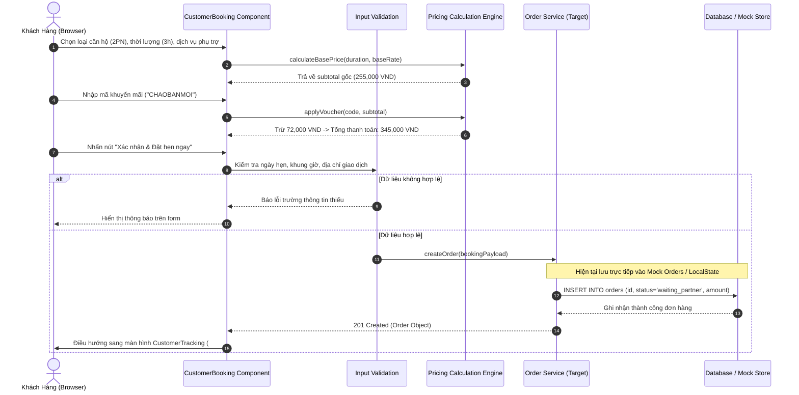
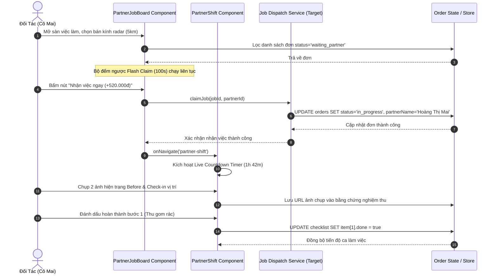

# Core Services & API Specifications

Tài liệu này phân tích chuyên sâu về ranh giới nghiệp vụ (*Domain Boundaries*), các đặc tả giao tiếp API (*API Specifications*), luồng luân chuyển dữ liệu (*End-to-End Data Flow*) và chiến lược xử lý ngoại lệ của hệ thống **Gia Đình Xanh**.

> [!IMPORTANT]
> **Kết Quả Kiểm Tra Kiến Trúc (Architectural Audit):**
> Trong cấu trúc repository hiện thời, hai thư mục `src/services/` và `src/api/` (cùng các thư mục backend truyền thống như `src/controllers/`, `src/routes/`) mang trạng thái: **Not configured/Found**.
> 
> Toàn bộ logic nghiệp vụ (Domain Logic), thuật toán tính toán, quy tắc xác thực và điều phối trạng thái hiện được đóng gói trực tiếp bên trong các mô-đun thành phần tại `src/components/` kết hợp cùng kiểu dữ liệu tại `src/types/index.ts` và bộ dữ liệu cố định tại `src/data/mockData.ts`. Tài liệu này phân tích chi tiết các miền nghiệp vụ thực tế tương đương và ánh xạ sang đặc tả API tiêu chuẩn chuẩn bị cho giai đoạn Backend Production.

---

## 1. Domain / Module Breakdown

Dưới đây là phân rã các miền nghiệp vụ cốt lõi trích xuất từ mã nguồn thực tế:

### Module: Booking & Pricing Domain
- **Tệp nguồn tương đương:** [`src/components/customer/CustomerBooking.tsx`](file:///d:/hao/Downloads/html/gia-%C4%91%C3%ACnh-xanh---n%E1%BB%81n-t%E1%BA%A3ng-d%E1%BB%8Bch-v%E1%BB%A5-gia-%C4%91%C3%ACnh-5-sao/src/components/customer/CustomerBooking.tsx), [`src/components/admin/AdminPricing.tsx`](file:///d:/hao/Downloads/html/gia-%C4%91%C3%ACnh-xanh---n%E1%BB%81n-t%E1%BA%A3ng-d%E1%BB%8Bch-v%E1%BB%A5-gia-%C4%91%C3%ACnh-5-sao/src/components/admin/AdminPricing.tsx)
- **Trách nhiệm chính (Core Responsibility):** Quản lý toàn bộ cấu hình dịch vụ gia đình, tính toán biểu giá động (Dynamic Pricing Engine) dựa trên thời lượng, phụ phí cuối tuần/giờ cao điểm, dịch vụ cộng thêm và khấu trừ mã khuyến mãi.
- **Dependencies:**
  - `ScreenId` từ [`src/types/index.ts`](file:///d:/hao/Downloads/html/gia-%C4%91%C3%ACnh-xanh---n%E1%BB%81n-t%E1%BA%A3ng-d%E1%BB%8Bch-v%E1%BB%A5-gia-%C4%91%C3%ACnh-5-sao/src/types/index.ts) (Điều hướng sau khi đặt đơn).
  - Không có Repository/External Service được inject (Thực hiện in-memory math).
- **Public Interfaces / Methods (Logic Handlers):**
  - `calculateBasePrice(duration: 2 | 3 | 4, baseRate: number): number`
    - **Input:** `duration` (2, 3, hoặc 4 giờ), `baseRate` (mặc định 85,000 VND).
    - **Output:** Tổng đơn giá cơ bản (`duration * baseRate`).
  - `calculateAddons(addons: { tools: boolean; ironing: boolean; fridge: boolean; window: boolean }): number`
    - **Input:** Object chứa trạng thái các dịch vụ đi kèm (dụng cụ: 35k, ủi đồ: 50k, vệ sinh tủ lạnh: 80k, lau kính: 40k).
    - **Output:** Tổng tiền các dịch vụ gia tăng.
  - `calculateSimulatedPricing(service: 'clean' | 'cook' | 'deep', hours: number, isPeak: boolean, isWeekend: boolean): PricingSummary`
    - **Input:** Loại hình dịch vụ, số giờ làm, cờ giờ cao điểm (`peakMultiplier: 1.15`), cờ cuối tuần (`weekendSurcharge: 10,000 VND`).
    - **Output:** `{ totalCustomerPays: number, partnerEarnings: number, platformFee: number }` (Tỷ lệ chia sẻ đối tác mặc định 82%, phí nền tảng 18%).
  - `handleBookingSubmit(): void`
    - **Input:** Trigger sự kiện xác nhận thanh toán & đặt lịch.
    - **Output:** Chuyển trạng thái giao diện sang `customer-tracking`.

---

### Module: Shift Execution & Live Tracking Domain
- **Tệp nguồn tương đương:** [`src/components/partner/PartnerShift.tsx`](file:///d:/hao/Downloads/html/gia-%C4%91%C3%ACnh-xanh---n%E1%BB%81n-t%E1%BA%A3ng-d%E1%BB%8Bch-v%E1%BB%A5-gia-%C4%91%C3%ACnh-5-sao/src/components/partner/PartnerShift.tsx), [`src/components/customer/CustomerTracking.tsx`](file:///d:/hao/Downloads/html/gia-%C4%91%C3%ACnh-xanh---n%E1%BB%81n-t%E1%BA%A3ng-d%E1%BB%8Bch-v%E1%BB%A5-gia-%C4%91%C3%ACnh-5-sao/src/components/customer/CustomerTracking.tsx)
- **Trách nhiệm chính (Core Responsibility):** Điều phối và giám sát quy trình thực thi ca làm việc thực tế, duy trì đồng hồ đếm ngược hiện trường, kiểm soát danh mục nghiệm thu checklist 5 sao và tải lên bằng chứng hình ảnh Before/After.
- **Dependencies:**
  - `IMAGES` từ [`src/data/mockData.ts`](file:///d:/hao/Downloads/html/gia-%C4%91%C3%ACnh-xanh---n%E1%BB%81n-t%E1%BA%A3ng-d%E1%BB%8Bch-v%E1%BB%A5-gia-%C4%91%C3%ACnh-5-sao/src/data/mockData.ts) (Hình ảnh mẫu hiện trạng Before/After).
  - Web Browser `setInterval` API (Mô phỏng bộ đếm thời gian thực).
- **Public Interfaces / Methods (Logic Handlers):**
  - `tickCountdownTimer(): void`
    - **Input:** Trạng thái `totalSeconds: number` (khởi tạo 1h 42m 11s), cờ `isPaused: boolean`.
    - **Output:** Giảm `totalSeconds` theo từng nhịp 1000ms.
  - `formatTimer(totalSeconds: number): string`
    - **Input:** `totalSeconds: number`.
    - **Output:** Chuỗi thời gian định dạng chuẩn `HH:MM:SS`.
  - `toggleChecklistItem(id: number): void`
    - **Input:** `id: number` của đầu việc trong danh mục ca làm.
    - **Output:** Đảo trạng thái `{ checked: boolean, inProgress: boolean }` của bước dọn dẹp tương ứng.

---

### Module: Dispatching & Radar Job Board Domain
- **Tệp nguồn tương đương:** [`src/components/partner/PartnerJobBoard.tsx`](file:///d:/hao/Downloads/html/gia-%C4%91%C3%ACnh-xanh---n%E1%BB%81n-t%E1%BA%A3ng-d%E1%BB%8Bch-v%E1%BB%A5-gia-%C4%91%C3%ACnh-5-sao/src/components/partner/PartnerJobBoard.tsx), [`src/components/admin/AdminDashboard.tsx`](file:///d:/hao/Downloads/html/gia-%C4%91%C3%ACnh-xanh---n%E1%BB%81n-t%E1%BA%A3ng-d%E1%BB%8Bch-v%E1%BB%A5-gia-%C4%91%C3%ACnh-5-sao/src/components/admin/AdminDashboard.tsx)
- **Trách nhiệm chính (Core Responsibility):** Phân phối đơn hàng theo thời gian thực tới đối tác lân cận bằng bộ lọc radar bán kính GPS và xử lý quyền nhận việc khẩn cấp với giới hạn thời gian (Flash Claim).
- **Dependencies:**
  - `INITIAL_ORDERS` từ [`src/data/mockData.ts`](file:///d:/hao/Downloads/html/gia-%C4%91%C3%ACnh-xanh---n%E1%BB%81n-t%E1%BA%A3ng-d%E1%BB%8Bch-v%E1%BB%A5-gia-%C4%91%C3%ACnh-5-sao/src/data/mockData.ts).
  - Kiểu dữ liệu `OrderItem` từ [`src/types/index.ts`](file:///d:/hao/Downloads/html/gia-%C4%91%C3%ACnh-xanh---n%E1%BB%81n-t%E1%BA%A3ng-d%E1%BB%8Bch-v%E1%BB%A5-gia-%C4%91%C3%ACnh-5-sao/src/types/index.ts).
- **Public Interfaces / Methods (Logic Handlers):**
  - `filterOrders(status: string, query: string): OrderItem[]`
    - **Input:** Trạng thái đơn (`all`, `in_progress`, `dispute`, `waiting_partner`, `in_transit`, `completed`) và từ khóa tìm kiếm.
    - **Output:** Mảng đơn hàng `OrderItem[]` thỏa mãn điều kiện lọc.
  - `handleAcceptJob(jobId: string): void`
    - **Input:** `jobId: string` (ví dụ: `#GDX-89241`).
    - **Output:** Ghi nhận `jobId` vào mảng `acceptedOrders`, hiển thị thông báo phản hồi và điều hướng đối tác vào `partner-shift`.
  - `reassignPartner(orderId: string, newPartnerName: string): void`
    - **Input:** `orderId: string`, `newPartnerName: string`.
    - **Output:** Cập nhật thợ phụ trách và chuyển trạng thái đơn hàng từ `dispute` sang `in_transit`.

---

### Module: Partner KYC Verification & Compliance Domain
- **Tệp nguồn tương đương:** [`src/components/admin/AdminKYC.tsx`](file:///d:/hao/Downloads/html/gia-%C4%91%C3%ACnh-xanh---n%E1%BB%81n-t%E1%BA%A3ng-d%E1%BB%8Bch-v%E1%BB%A5-gia-%C4%91%C3%ACnh-5-sao/src/components/admin/AdminKYC.tsx)
- **Trách nhiệm chính (Core Responsibility):** Thực hiện quy trình thẩm định nhân sự và cấp chứng nhận hành nghề 5 sao qua 4 cổng xác thực: CCCD, Lý lịch tư pháp, Giấy khám sức khỏe và Điểm thi sát hạch lý thuyết/thực hành.
- **Dependencies:**
  - `KYC_CANDIDATES` từ [`src/data/mockData.ts`](file:///d:/hao/Downloads/html/gia-%C4%91%C3%ACnh-xanh---n%E1%BB%81n-t%E1%BA%A3ng-d%E1%BB%8Bch-v%E1%BB%A5-gia-%C4%91%C3%ACnh-5-sao/src/data/mockData.ts).
  - Kiểu dữ liệu `KYCCandidate` từ [`src/types/index.ts`](file:///d:/hao/Downloads/html/gia-%C4%91%C3%ACnh-xanh---n%E1%BB%81n-t%E1%BA%A3ng-d%E1%BB%8Bch-v%E1%BB%A5-gia-%C4%91%C3%ACnh-5-sao/src/types/index.ts).
- **Public Interfaces / Methods (Logic Handlers):**
  - `handleApprove(id: string): void`
    - **Input:** `id: string` hồ sơ ứng viên (ví dụ: `KYC-2025-084`).
    - **Output:** Chuyển trạng thái hồ sơ thành `approved` và nhãn `Đã kích hoạt 5★`.
  - `handleReject(id: string): void`
    - **Input:** `id: string` hồ sơ ứng viên.
    - **Output:** Chuyển trạng thái hồ sơ thành `rejected` và nhãn `Từ chối`.

---

### Module: Partner Finance & Availability Schedule Domain
- **Tệp nguồn tương đương:** [`src/components/partner/PartnerWallet.tsx`](file:///d:/hao/Downloads/html/gia-%C4%91%C3%ACnh-xanh---n%E1%BB%81n-t%E1%BA%A3ng-d%E1%BB%8Bch-v%E1%BB%A5-gia-%C4%91%C3%ACnh-5-sao/src/components/partner/PartnerWallet.tsx)
- **Trách nhiệm chính (Core Responsibility):** Quản trị số dư ví thu nhập của đối tác, xử lý yêu cầu rút tiền và quản lý ma trận đăng ký lịch rảnh 7 ngày trong tuần theo 3 khung giờ (Sáng, Chiều, Tối).
- **Dependencies:** Không phụ thuộc thư viện ngoài; quản lý trạng thái cục bộ dạng ma trận `{ [slotKey: string]: number }`.
- **Public Interfaces / Methods (Logic Handlers):**
  - `toggleSlot(dayIndex: number, slotId: 'morning' | 'afternoon' | 'evening'): void`
    - **Input:** `dayIndex` (0 đến 6) và `slotId`.
    - **Output:** Đảo trạng thái giữa `0` (Nghỉ) và `1` (Đăng ký rảnh). Bỏ qua nếu giá trị là `2` (Đã được hệ thống khóa ca làm - `Booked`).
  - `executeWithdrawal(amount: number): boolean`
    - **Input:** Số tiền cần rút về tài khoản ngân hàng liên kết.
    - **Output:** Trả về `true` khi yêu cầu rút tiền thành công.

---

## 2. API Endpoints Catalog

Do `src/api/` hiện **chưa được cấu hình trong mã nguồn**, bảng dưới đây tổng hợp các Route/Endpoint định chuẩn được trích xuất và quy chiếu trực tiếp từ các thao tác nghiệp vụ đang hoạt động trong UI components:

| Method | Endpoint Path | Controller / Component Handler Nguồn | Auth Required? | Mô tả chức năng ngắn gọn | Trạng thái Codebase |
|:---|:---|:---|:---|:---|:---|
| **POST** | `/api/v1/bookings` | `CustomerBooking.tsx` (`handleBookingSubmit`) | Khách hàng (Session / Bearer) | Khởi tạo đơn đặt dịch vụ (tính toán đơn giá, phụ phí và voucher) | *Chưa triển khai Backend* |
| **GET** | `/api/v1/orders/tracking/:id` | `CustomerTracking.tsx` | Khách hàng (Bearer Token) | Lấy thông tin chi tiết ca làm, checklist và ảnh Before/After live | *Chưa triển khai Backend* |
| **POST** | `/api/v1/orders/:id/rating` | `RatingModal.tsx` (`handleSubmit`) | Khách hàng (Bearer Token) | Gửi đánh giá 5 sao, bộ tag nhận xét và tiền tip cho đối tác | *Chưa triển khai Backend* |
| **GET** | `/api/v1/partner/jobs/radar` | `PartnerJobBoard.tsx` | Đối tác (Bearer Token) | Lấy danh sách đơn hàng khả dụng theo bộ lọc bán kính (2km-10km) | *Chưa triển khai Backend* |
| **POST** | `/api/v1/partner/jobs/:id/accept` | `PartnerJobBoard.tsx` (`handleAcceptJob`) | Đối tác (Bearer Token) | Nhận đơn hàng khẩn cấp trước khi hết thời gian đếm ngược flash | *Chưa triển khai Backend* |
| **PATCH** | `/api/v1/partner/shifts/:id/checklist` | `PartnerShift.tsx` (`toggleChecklistItem`) | Đối tác (Bearer Token) | Cập nhật tiến độ từng hạng mục công việc trong ca làm | *Chưa triển khai Backend* |
| **POST** | `/api/v1/partner/wallet/withdraw` | `PartnerWallet.tsx` (`handleWithdraw`) | Đối tác (Bearer Token) | Tạo yêu cầu rút tiền từ ví thu nhập về tài khoản ngân hàng | *Chưa triển khai Backend* |
| **PUT** | `/api/v1/partner/schedule` | `PartnerWallet.tsx` (`toggleSlot`) | Đối tác (Bearer Token) | Cập nhật ma trận ca rảnh trong tuần (Sáng/Chiều/Tối) | *Chưa triển khai Backend* |
| **GET** | `/api/v1/admin/orders` | `AdminDashboard.tsx` (`filteredOrders`) | Quản trị viên (Admin RBAC) | Lấy danh sách toàn bộ đơn hàng kèm bộ lọc trạng thái và tìm kiếm | *Chưa triển khai Backend* |
| **POST** | `/api/v1/admin/orders/:id/reassign` | `AdminDashboard.tsx` (`reassignPartner`) | Quản trị viên (Admin RBAC) | Điều phối gán lại thợ cho đơn hàng bị tranh chấp hoặc quá hạn | *Chưa triển khai Backend* |
| **POST** | `/api/v1/admin/kyc/:id/approve` | `AdminKYC.tsx` (`handleApprove`) | Quản trị viên (Admin RBAC) | Duyệt hồ sơ đối tác 4 bước và kích hoạt tài khoản chuẩn 5 sao | *Chưa triển khai Backend* |
| **POST** | `/api/v1/admin/kyc/:id/reject` | `AdminKYC.tsx` (`handleReject`) | Quản trị viên (Admin RBAC) | Từ chối hồ sơ đối tác và gửi yêu cầu bổ sung giấy tờ | *Chưa triển khai Backend* |
| **POST** | `/api/v1/admin/pricing/simulate` | `AdminPricing.tsx` (`calculateSimulatedPricing`) | Quản trị viên (Admin RBAC) | Mô phỏng và cập nhật biểu giá sàn, hệ số cao điểm và tỷ lệ chia sẻ | *Chưa triển khai Backend* |

---

## 3. End-to-End Data Flow (Mermaid Sequence Diagram)

Dưới đây là 02 luồng dữ liệu nghiệp vụ quan trọng nhất của nền tảng, mô tả chi tiết từ tương tác Client qua các tầng xử lý và lưu trữ dữ liệu:

### 3.1. Luồng 1: Đặt Dịch Vụ & Khởi Tạo Đơn Hàng (Customer Booking Flow)

Luồng mô tả cách thức Khách hàng chọn cấu hình dịch vụ, áp dụng khuyến mãi, tính giá và luân chuyển dữ liệu đến đơn vị điều phối:



---

### 3.2. Luồng 2: Nhận Đơn Khẩn Cấp & Bắt Đầu Ca Làm Việc Hiện Trường (Partner Job Claim & Shift Flow)

Luồng mô tả cách thức Đối tác nhận việc từ Sàn radar và bắt đầu vận hành ca làm việc kèm checklist:



---

## 4. Error Handling & Data Validation Strategy

### 4.1. Cơ Chế Xử Lý Ngoại Lệ (Error Handling Strategy)
- **Hiện trạng Codebase:**
  - Do chưa có backend server Node.js/Express, hệ thống **chưa thiết lập** các cơ chế xử lý lỗi tập trung như Global Exception Filters (NestJS) hoặc Error-handling Middleware (`(err, req, res, next) => {}`).
  - Trong tầng Client hiện thời:
    - **Dialog Cảnh Báo Trực Tiếp:** Sử dụng hàm `alert(...)` của trình duyệt để thông báo phản hồi thao tác tức thì cho người dùng (ví dụ: thông báo xác nhận nhận việc trong [`src/components/partner/PartnerJobBoard.tsx#L31`](file:///d:/hao/Downloads/html/gia-%C4%91%C3%ACnh-xanh---n%E1%BB%81n-t%E1%BA%A3ng-d%E1%BB%8Bch-v%E1%BB%A5-gia-%C4%91%C3%ACnh-5-sao/src/components/partner/PartnerJobBoard.tsx#L31)).
    - **Xử lý Null/Undefined An Toàn:** Sử dụng Optional Chaining (`?.`) và Fallback Defaults khi duyệt danh sách đơn hàng và ứng viên KYC (tránh gây vỡ giao diện React khi thiếu trường dữ liệu).
    - **Tự động phục hồi trạng thái (Auto-dismiss Alert):** Trong [`src/components/admin/AdminPricing.tsx`](file:///d:/hao/Downloads/html/gia-%C4%91%C3%ACnh-xanh---n%E1%BB%81n-t%E1%BA%A3ng-d%E1%BB%8Bch-v%E1%BB%A5-gia-%C4%91%C3%ACnh-5-sao/src/components/admin/AdminPricing.tsx), sự kiện lưu cấu hình giá sử dụng cờ `isSavedAlert` kết hợp `setTimeout(..., 3000)` để đóng thông báo tự động.
- **Khuyến nghị kiến trúc Backend:**
  - Cần xây dựng lớp `HttpException` kế thừa chuẩn lỗi RFC 7807 (*Problem Details for HTTP APIs*).
  - Triển khai Global Error Middleware bắt trọn vẹn lỗi bất đồng bộ và trả về định dạng chuẩn:
    ```json
    {
      "success": false,
      "errorCode": "ORDER_ALREADY_CLAIMED",
      "message": "Đơn hàng đã được đối tác khác tiếp nhận.",
      "timestamp": "2026-09-28T22:05:00Z"
    }
    ```

### 4.2. Chiến Lược Xác Thực Dữ Liệu Đầu Vào (Data Validation Strategy)
- **Hiện trạng Codebase:**
  - **Chưa có thư viện xác thực schema chuyên dụng:** Không tìm thấy các thư viện như `zod`, `joi`, `yup` hay `class-validator` trong `package.json`.
  - **Kiểm soát kiểu dữ liệu tĩnh tại Compile-time:** Toàn bộ cấu trúc thực thể đầu vào được ràng buộc nghiêm ngặt bằng TypeScript interfaces tại [`src/types/index.ts`](file:///d:/hao/Downloads/html/gia-%C4%91%C3%ACnh-xanh---n%E1%BB%81n-t%E1%BA%A3ng-d%E1%BB%8Bch-v%E1%BB%A5-gia-%C4%91%C3%ACnh-5-sao/src/types/index.ts):
    - `ScreenId`: Ràng buộc danh sách 10 màn hình hợp lệ.
    - `OrderItem['status']`: Ràng buộc chỉ nhận các trạng thái: `'pending' | 'in_progress' | 'dispute' | 'completed' | 'waiting_partner' | 'in_transit'`.
    - `KYCCandidate['status']`: Ràng buộc chỉ nhận `'pending' | 'needs_update' | 'approved' | 'rejected'`.
  - **Xác thực biểu mẫu HTML5 & State Clamping:**
    - Sử dụng các thuộc tính biểu mẫu HTML5 chuẩn (`min`, `max`, `readOnly`) cho các input số tiền rút ví, số giờ dọn dẹp.
    - Chặn logic nghiệp vụ: Trong [`src/components/partner/PartnerWallet.tsx`](file:///d:/hao/Downloads/html/gia-%C4%91%C3%ACnh-xanh---n%E1%BB%81n-t%E1%BA%A3ng-d%E1%BB%8Bch-v%E1%BB%A5-gia-%C4%91%C3%ACnh-5-sao/src/components/partner/PartnerWallet.tsx), hàm `toggleSlot` có đoạn kiểm tra `if (current === 2) return prev;` nhằm ngăn chặn đối tác tự ý hủy các ca làm việc đã có khách đặt trước.
- **Khuyến nghị kiến trúc Backend:**
  - Bổ sung thư viện `zod` vào dự án để xác thực payload đầu vào tại tầng Controller/Middleware trước khi chạm vào Service logic, ví dụ: `BookingCreateSchema`, `KycApprovalSchema`, `PartnerWithdrawSchema`.
