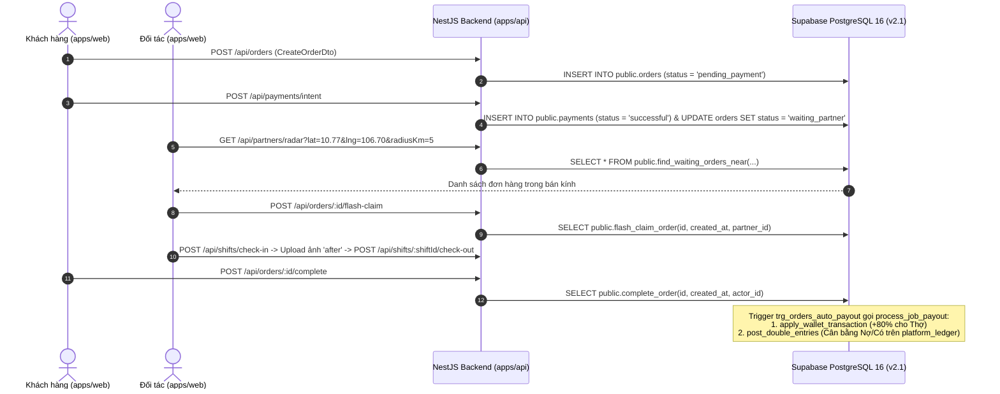

# Core Services & API Specifications (Supabase Schema v2.1)

## 1. Domain/Module Breakdown

Hệ thống được phân tách thành gói hợp đồng kiểu dữ liệu dùng chung (`packages/shared-types`), tầng dịch vụ Frontend (`apps/web/src/services/`), tầng kết nối cơ sở dữ liệu toàn cục (`DatabaseModule`) và **11 Domain Modules** tại Backend NestJS (`apps/api/src/modules/`) tương thích 100% với **Supabase PostgreSQL v2.1 Schema**:

### 1.1. Backend Domain Modules (`apps/api/src/modules/`)

- **Module: `DatabaseModule`** ([`apps/api/src/database/database.module.ts`](file:///d:/hao/Downloads/html/gia-%C4%91%C3%ACnh-xanh---n%E1%BB%81n-t%E1%BA%A3ng-d%E1%BB%8Bch-v%E1%BB%A5-gia-%C4%91%C3%ACnh-5-sao/apps/api/src/database/database.module.ts))
  - **Trách nhiệm chính:** Quản lý `pg.Pool` kết nối tới Supabase PostgreSQL 16 (SSL Pooler), tự động thiết lập `SET LOCAL search_path = public, extensions` và ngữ cảnh RLS `set_config('app.current_user_id', userId, true)` trong từng giao dịch (`withUserContext`). Tự động chuyển sang chế độ Fallback an toàn nếu biến `DATABASE_URL` chưa được điền.

- **Module: `AuthModule`** ([`apps/api/src/modules/auth/auth.module.ts`](file:///d:/hao/Downloads/html/gia-%C4%91%C3%ACnh-xanh---n%E1%BB%81n-t%E1%BA%A3ng-d%E1%BB%8Bch-v%E1%BB%A5-gia-%C4%91%C3%ACnh-5-sao/apps/api/src/modules/auth/auth.module.ts))
  - **Trách nhiệm chính:** Lưu mã băm OTP vào bảng `public.otp_codes` (`purpose`: `'login' | 'register' | 'reset_password'`), xác thực người dùng trong `public.users` và quản lý phiên đăng nhập trong `public.user_sessions`.
  - **Public Methods:** `requestOtp(phone: string, purpose: OtpPurpose)`, `verifyOtp(phone: string, otp: string, role: UserRole)`.

- **Module: `UsersModule`** ([`apps/api/src/modules/users/users.module.ts`](file:///d:/hao/Downloads/html/gia-%C4%91%C3%ACnh-xanh---n%E1%BB%81n-t%E1%BA%A3ng-d%E1%BB%8Bch-v%E1%BB%A5-gia-%C4%91%C3%ACnh-5-sao/apps/api/src/modules/users/users.module.ts))
  - **Trách nhiệm chính:** Quản lý hồ sơ người dùng (`UserEntity` — `public.users`), danh mục hành chính (`public.provinces`, `public.wards`) và sổ địa chỉ định vị tọa độ không gian PostGIS (`public.user_addresses`).
  - **Public Methods:** `findAll()`, `findOne(id)`, `getProvinces()`, `getWards(provinceCode)`, `getUserAddresses(userId)`, `addUserAddress(userId, payload)`.

- **Module: `PartnersModule`** ([`apps/api/src/modules/partners/partners.module.ts`](file:///d:/hao/Downloads/html/gia-%C4%91%C3%ACnh-xanh---n%E1%BB%81n-t%E1%BA%A3ng-d%E1%BB%8Bch-v%E1%BB%A5-gia-%C4%91%C3%ACnh-5-sao/apps/api/src/modules/partners/partners.module.ts))
  - **Trách nhiệm chính:** Quản lý hồ sơ đối tác (`PartnerProfileEntity` — `public.partner_profiles`), mã hóa CCCD chuẩn Nghị định 13/2023 bằng hàm PL/pgSQL `public.encrypt_cccd` & `public.hash_cccd`, cập nhật vị trí GPS thực tế qua `public.record_partner_location`, và quét đơn hàng chờ xung quanh bằng hàm `public.find_waiting_orders_near`.
  - **Public Methods:** `findNearbyJobs(lat, lng, radiusKm)`, `recordLocation(dto)`, `upsertPartnerProfile(partnerId, payload)`, `getKycCandidates()`, `updateKycStatus(partnerId, dto)`, `getSchedules(partnerId)`.

- **Module: `ServicesModule`** ([`apps/api/src/modules/services/services.module.ts`](file:///d:/hao/Downloads/html/gia-%C4%91%C3%ACnh-xanh---n%E1%BB%81n-t%E1%BA%A3ng-d%E1%BB%8Bch-v%E1%BB%A5-gia-%C4%91%C3%ACnh-5-sao/apps/api/src/modules/services/services.module.ts))
  - **Trách nhiệm chính:** Truy vấn danh mục dịch vụ (`public.service_categories`: `CLEANING`, `COOKING`, `LAUNDRY`, `DEEP_CLEAN`), dịch vụ cộng thêm (`public.service_addons`: `IRON`, `DISHES`, `FRIDGE`, `SOFA`), quy tắc giá động (`public.pricing_rules`), checklist mẫu (`public.checklist_templates`) và mã khuyến mãi (`public.vouchers`).

- **Module: `OrdersModule`** ([`apps/api/src/modules/orders/orders.module.ts`](file:///d:/hao/Downloads/html/gia-%C4%91%C3%ACnh-xanh---n%E1%BB%81n-t%E1%BA%A3ng-d%E1%BB%8Bch-v%E1%BB%A5-gia-%C4%91%C3%ACnh-5-sao/apps/api/src/modules/orders/orders.module.ts))
  - **Trách nhiệm chính:** Quản lý bảng phân vùng theo tháng `public.orders` (khóa chính kép `(id, created_at)`), đảm bảo các bất biến tài chính (`final_amount = base_amount + addon_amount + surcharge_amount - discount_amount` và `partner_payout_amount + platform_fee_amount >= final_amount`), nhận việc chống tranh chấp qua `public.flash_claim_order` (`FOR UPDATE SKIP LOCKED`), và hoàn tất đơn qua `public.complete_order` (kích hoạt trigger `trg_orders_auto_payout` -> `public.process_job_payout`).
  - **Public Methods:** `findAll()`, `findOne(id)`, `create(dto)`, `flashClaim(id, dto)`, `completeOrder(id, dto)`, `submitReview(id, dto)`, `updateStatus(id, status, orderCreatedAt)`.

- **Module: `ShiftsModule`** ([`apps/api/src/modules/shifts/shifts.module.ts`](file:///d:/hao/Downloads/html/gia-%C4%91%C3%ACnh-xanh---n%E1%BB%81n-t%E1%BA%A3ng-d%E1%BB%8Bch-v%E1%BB%A5-gia-%C4%91%C3%ACnh-5-sao/apps/api/src/modules/shifts/shifts.module.ts))
  - **Trách nhiệm chính:** Quản lý ca làm việc (`public.shifts`), tự động sinh danh sách công việc (`public.shift_checklists` qua trigger `trg_shifts_gen_checklist`), lưu ảnh nghiệm thu trước/sau (`public.shift_evidences`) và kiểm tra tọa độ GPS bán kính 500m khi kết thúc ca qua `public.check_out_shift`.

- **Modules Tài chính, Sổ cái & Vận hành:**
  - `PaymentsModule` ([`payments.module.ts`](file:///d:/hao/Downloads/html/gia-%C4%91%C3%ACnh-xanh---n%E1%BB%81n-t%E1%BA%A3ng-d%E1%BB%8Bch-v%E1%BB%A5-gia-%C4%91%C3%ACnh-5-sao/apps/api/src/modules/payments/payments.module.ts)): Ghi nhận giao dịch cổng thanh toán (`public.payments`) thỏa mãn `trg_orders_guard` trước khi mở đơn lên Radar, và quản lý ví khách hàng qua `public.apply_customer_wallet_transaction`.
  - `WalletsModule` ([`wallets.module.ts`](file:///d:/hao/Downloads/html/gia-%C4%91%C3%ACnh-xanh---n%E1%BB%81n-t%E1%BA%A3ng-d%E1%BB%8Bch-v%E1%BB%A5-gia-%C4%91%C3%ACnh-5-sao/apps/api/src/modules/wallets/wallets.module.ts)): Quản lý ví đối tác (`public.partner_wallets`), bảng phân vùng `public.wallet_transactions` và quy trình rút tiền 3 bước (`public.create_payout_request`, `public.approve_payout_request`, `public.complete_payout_request`, `public.reject_payout_request`).
  - `LedgerModule` ([`ledger.module.ts`](file:///d:/hao/Downloads/html/gia-%C4%91%C3%ACnh-xanh---n%E1%BB%81n-t%E1%BA%A3ng-d%E1%BB%8Bch-v%E1%BB%A5-gia-%C4%91%C3%ACnh-5-sao/apps/api/src/modules/ledger/ledger.module.ts)): Sổ cái kế toán kép bất biến (`public.platform_ledger`), hàm ghi sổ cân bằng `public.post_double_entries` và các view đối soát `public.v_ledger_account_summary`, `public.v_ledger_unbalanced_groups`.
  - `DisputesModule` ([`disputes.module.ts`](file:///d:/hao/Downloads/html/gia-%C4%91%C3%ACnh-xanh---n%E1%BB%81n-t%E1%BA%A3ng-d%E1%BB%8Bch-v%E1%BB%A5-gia-%C4%91%C3%ACnh-5-sao/apps/api/src/modules/disputes/disputes.module.ts)) & `NotificationsModule` ([`notifications.module.ts`](file:///d:/hao/Downloads/html/gia-%C4%91%C3%ACnh-xanh---n%E1%BB%81n-t%E1%BA%A3ng-d%E1%BB%8Bch-v%E1%BB%A5-gia-%C4%91%C3%ACnh-5-sao/apps/api/src/modules/notifications/notifications.module.ts)).

---

## 2. API Endpoints Catalog

| Method | Endpoint Path | Controller / Action | Stored Procedure / Table (v2.1) | Mô tả chức năng ngắn gọn |
|---|---|---|---|---|
| `GET` | `/api/health` | `HealthController.check` | `SELECT 1` | Kiểm tra trạng thái máy chủ NestJS và kết nối Supabase v2.1 |
| `POST` | `/api/auth/otp/request` | `AuthController.requestOtp` | `public.otp_codes` | Yêu cầu gửi mã OTP về số điện thoại |
| `POST` | `/api/auth/otp/verify` | `AuthController.verifyOtp` | `public.users`, `public.user_sessions` | Xác thực OTP và nhận cặp JWT Access/Refresh Token |
| `GET` | `/api/services` | `ServicesController.findAll` | `public.service_categories` | Lấy danh mục 4 gói dịch vụ cốt lõi |
| `GET` | `/api/services/addons` | `ServicesController.findAddons` | `public.service_addons` | Lấy danh sách dịch vụ cộng thêm (`IRON`, `DISHES`, `FRIDGE`, `SOFA`) |
| `GET` | `/api/orders` | `OrdersController.findAll` | `public.orders` | Lấy danh sách đơn hàng (phân vùng theo `created_at`) |
| `POST` | `/api/orders` | `OrdersController.create` | `public.orders` | Tạo đơn hàng mới từ cấu hình Wizard của khách hàng |
| `POST` | `/api/orders/:id/flash-claim` | `OrdersController.flashClaim` | `public.flash_claim_order` | Đối tác nhận việc nhanh chống race condition (`SKIP LOCKED`) |
| `POST` | `/api/orders/:id/complete` | `OrdersController.completeOrder` | `public.complete_order` | Nghiệm thu đơn hàng & tự động chia tiền ví + ghi sổ cái kép |
| `POST` | `/api/orders/:id/reviews` | `OrdersController.submitReview` | `public.order_reviews` | Đánh giá sao đối tác (kích hoạt `trg_reviews_recalc_rating`) |
| `GET` | `/api/partners/radar` | `PartnersController.getRadarJobs` | `public.find_waiting_orders_near` | Quét đơn hàng xung quanh tọa độ GPS bằng chỉ mục GiST PostGIS |
| `POST` | `/api/partners/:partnerId/location` | `PartnersController.recordLocation` | `public.record_partner_location` | Cập nhật tọa độ GPS hiện tại và lịch sử di chuyển của đối tác |
| `POST` | `/api/partners/:partnerId/profile` | `PartnersController.upsertProfile` | `public.encrypt_cccd`, `public.hash_cccd` | Lưu thông tin CCCD mã hóa AES-256 + băm HMAC-SHA256 |
| `GET` | `/api/partners/kyc` | `PartnersController.getKycList` | `public.partner_profiles` | Lấy danh sách ứng viên đối tác chờ xét duyệt KYC |
| `PATCH` | `/api/partners/:partnerId/kyc` | `PartnersController.updateKyc` | `public.partner_profiles` | Phê duyệt hoặc từ chối hồ sơ KYC |
| `GET` | `/api/shifts/:orderId` | `ShiftsController.getShift` | `public.shifts`, `public.shift_checklists` | Lấy thông tin ca làm việc, checklist và ảnh Before/After |
| `POST` | `/api/shifts/check-in` | `ShiftsController.checkIn` | `public.shifts` | Bắt đầu ca làm việc & tự động sinh checklist theo loại dịch vụ |
| `POST` | `/api/shifts/:shiftId/check-out` | `ShiftsController.checkOut` | `public.check_out_shift` | Kết thúc ca làm việc (xác thực khoảng cách GPS <= 500m) |
| `POST` | `/api/payments/intent` | `PaymentsController.createIntent` | `public.payments` | Ghi nhận thanh toán thành công và mở đơn sang `waiting_partner` |
| `GET` | `/api/wallets/:partnerId` | `WalletsController.getWallet` | `public.partner_wallets`, `public.wallet_transactions` | Tra cứu số dư khả dụng, số dư chờ rút và lịch sử biến động ví |
| `POST` | `/api/wallets/:partnerId/payout` | `WalletsController.requestPayout` | `public.create_payout_request` | Tạo yêu cầu rút tiền (chuyển từ `current_balance` sang `pending_balance`) |
| `GET` | `/api/ledger` | `LedgerController.findAll` | `public.platform_ledger` | Tra cứu bút toán kép trên sổ cái nền tảng |
| `GET` | `/api/ledger/summary` | `LedgerController.getSummary` | `public.v_ledger_account_summary` | Đối soát tổng phát sinh Nợ/Có và kiểm tra nhóm bút toán lệch |

---

## 3. End-to-End Data Flow (Mermaid Sequence Diagram)

---

## 4. Error Handling & Data Validation Strategy
- **Global Validation Pipe:** Kích hoạt tại [`apps/api/src/main.ts`](file:///d:/hao/Downloads/html/gia-%C4%91%C3%ACnh-xanh---n%E1%BB%81n-t%E1%BA%A3ng-d%E1%BB%8Bch-v%E1%BB%A5-gia-%C4%91%C3%ACnh-5-sao/apps/api/src/main.ts) với `whitelist: true` và `transform: true` kết hợp `class-validator` / `class-transformer` và hợp đồng kiểu dữ liệu `@gdx/shared-types`.
- **Exception Filters:**
  - [`HttpExceptionFilter`](file:///d:/hao/Downloads/html/gia-%C4%91%C3%ACnh-xanh---n%E1%BB%81n-t%E1%BA%A3ng-d%E1%BB%8Bch-v%E1%BB%A5-gia-%C4%91%C3%ACnh-5-sao/apps/api/src/common/filters/http-exception.filter.ts): Chuẩn hóa cấu trúc phản hồi lỗi HTTP (`statusCode`, `timestamp`, `path`, `message`).
  - [`DatabaseExceptionFilter`](file:///d:/hao/Downloads/html/gia-%C4%91%C3%ACnh-xanh---n%E1%BB%81n-t%E1%BA%A3ng-d%E1%BB%8Bch-v%E1%BB%A5-gia-%C4%91%C3%ACnh-5-sao/apps/api/src/common/filters/database-exception.filter.ts): Bắt các ngoại lệ `QueryFailedError` và `RAISE EXCEPTION` từ các hàm PL/pgSQL trên Supabase (ví dụ: `ORDER_ALREADY_CLAIMED_OR_UNAVAILABLE`, `CHECKOUT_TOO_FAR_FROM_ORDER_LOCATION`, `UNBALANCED_LEDGER_GROUP`).
